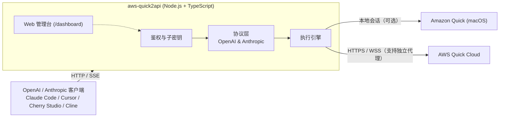
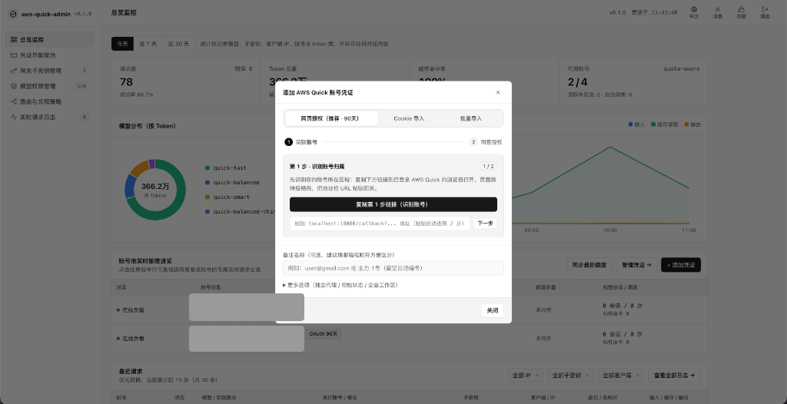
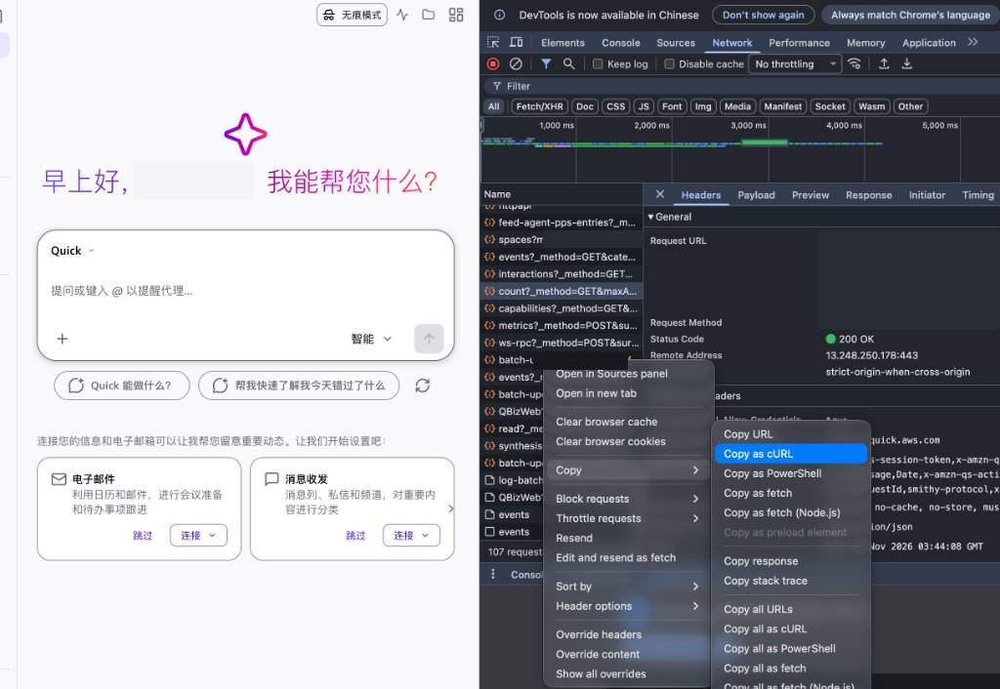

# aws-quick2api

简体中文 | **[English](./README_EN.md)**

[](https://github.com/kuk-888/aws-quick2api/releases)
[](https://github.com/kuk-888/aws-quick2api/pkgs/container/aws-quick2api)
[](https://linux.do)
[](./LICENSE)

面向 **AWS Quick** 的单进程 **OpenAI & Anthropic 双协议 API 网关**。可在 Linux、Docker、macOS、Windows 上独立运行，无需安装官方桌面端，内置轻量化 Web 管理台（`aws-quick-admin`）。

> **免责声明**：本项目为独立第三方开源项目，与 Amazon Web Services (AWS) 无任何官方关联或背书。仓库不包含任何 AWS 闭源二进制或专有资产，请使用本人合法账号授权。仅限个人开发与协议互通，请勿用于商业中转或转售。

---

## 主要特性

- **OpenAI & Anthropic 双协议接口**：同时提供 OpenAI（`/v1/chat/completions`、`/v1/responses`、`/v1/models`）与 Anthropic（`/v1/messages`、`/v1/messages/count_tokens`）端点，支持 SSE 流式输出、工具调用（Tool/Function Calling）、思考链与多模态识图（Base64 及带 SSRF 防护的 10 MB 内远端图片）。
- **免客户端多账号接入**：
  - Web 管理台内置 **2 步 OAuth PKCE 网页授权**（自动发现租户分片、90 天自动续期、自动提取真实邮箱与用户名）。
  - 支持浏览器 `Copy as cURL` 导入 Cookie、JSON 批量导入导出，以及 macOS 本机 `local-outpost` 会话复用。
- **长上下文与流式稳定性**：
  - 超长上下文（`>46 KB`）在 OAuth 账号下自动走 AWS Quick **原生带外 `.txt` 附件上传**（1 帧秒传 + 60s DLP 轮询校验 + 第 2 轮热续传）；非 OAuth 或降级场景自动按 `≤46.5 KB` 安全分片（内置 45s `turn_usage` 兜底与最高 12 块保护上限）；流式请求超 16 KB 或带工具调用时在获取上游槽位后提前发 `HTTP 200` + `: keepalive` 心跳（Anthropic 协议首帧后发标准 `event: ping`），既保留预租约真实 `429` 状态码又避免 Cloudflare `524` 超时。
  - 超 `850K` tokens 时触发网关兜底裁剪/摘要（`AUTO_COMPACT_OVERFLOW_TOKENS`，低于阈值完全不介入，不影响客户端 Prompt Cache 命中）。
  - 内置流式 XML 净化器：自动将 AWS Quick 私有的 `<decision>` / `<decisions>` / `<artifact>` 交互标签转为标准 Markdown，同时保护代码块原样输出。
- **自定义 Agent 自动绑定与零污染工具桥接**：
  - 默认开启 `AUTO_ENSURE_CODING_AGENT=true`：首次调用未绑定 Agent 的账号时，自动通过 AWS Quick 原生 WebSocket 协议查找已有自定义 Agent 或按模板创建并发布 `Coding Assistant`，持久化写入 `.env`（后续 0ms 额外开销）。
  - 自定义 Agent 生效后自动切换极简工具桥接（去除长篇防拒答文案，Opus / Sonnet 保持 `user_message` 零注入），稳定支持 Claude Code / Codex CLI / Witan 发起本地文件、`.env`、终端、MCP、Skill、`apply_patch` 等调用。
  - Web 管理台「路由与策略」支持热更新 `AUTO_ENSURE_CODING_AGENT` 开关与全局默认提示词模板 `CUSTOM_AGENT_PROMPT`；「凭证池」点击任意账号的 **Agent** 按钮即可实时查看该账号下所有自定义 Agent、一键切换/恢复默认、一键自动创建绑定，或**在线编辑并热发布已有 Agent 提示词到 AWS Quick**。
- **多账号调度与独立代理**：
  - 支持余量感知（`quota-aware`）、最少并发（`least-busy`）、轮询（`round-robin`）与会话粘性亲和；额度耗尽自动熔断，遇到 401/429/502/503 自动切换至健康账号。
  - 零依赖单账号独立出口代理，原生支持 `http://`、`https://`、`socks5://`、`socks5h://`（远程 DNS 解析）及常见简写（`ip:port`、`user:pass@ip:port`、`ip:port:user:pass`），内置住宅代理 `ECONNRESET` 瞬态断连自动重试。
- **无痕隐私与独占 WS 长连接热续传**：
  - 默认开启**原生无痕模式（`incognito: true`）+ 单会话独占 WebSocket 长连接保活热续传**：既不写入 AWS 云端历史记录、不刷爆官方侧边栏，又能像官方桌面端一样全协议（含 Claude Code / Codex / Witan 工具调用）增量续传，多轮首字低至 **1.4~3.2s**；5 重隔离锁杜绝串话，断连自动无感降级 `46.5 KB` 满载分片零失忆；关闭无痕时同步支持云端 `thread_id` 断连重连续传。
- **内置 Web 管理台（`aws-quick-admin`）**：
  - 访问 `/dashboard` 即可使用（中英双语、浅色/暗色主题）：总览图表与路由模型统计、实时配额与试用到期倒计时、按勾选精准同步额度、一键批量清理云端会话、`sk-aq-...` 子密钥管控（模型白名单/并发/限额/有效期）及实时请求追踪。

---

## 架构简图



---

## 界面预览

### 总览监控


### 凭证与额度池


<details>
<summary>展开查看更多管理台页面（网关子密钥 / 模型权限 / 路由与无痕策略）</summary>

#### 网关子密钥与快捷接入


#### 模型权限管理


#### 路由、亲和与无痕策略


</details>

---

## 凭证导入教程

启动服务并登录管理台（`http://127.0.0.1:3456/dashboard`）后，点击右上角 **「+ 添加凭证」**，提供两种常用接入方式：

### 方式一：网页 OAuth 授权（推荐 · 90 天自动续期）

无需安装官方桌面客户端，按弹窗内的 2 步向导操作即可（支持全网多区域租户自动发现、自动提取邮箱与姓名）：
1. 点击 **「复制第 1 步链接（识别账号）」**，在已登录 AWS Quick 的浏览器中打开；页面跳转到 `localhost:18080/callback?...` 后复制浏览器地址栏完整 URL 粘贴回输入框，自动进入第 2 步；
2. 复制第 2 步授权链接在浏览器点击 **Allow access**，同样将回调 URL 粘贴回来即完成入池。



### 方式二：浏览器 Cookie 导入（短期备用）

1. 在已登录 `quick.aws.com` 的浏览器按 `F12` 打开开发者工具 → 切到 **Network（网络）** → 右键任意 `quick.aws.com` 请求选择 **Copy → Copy as cURL**：



2. 切换到弹窗的 **「Cookie 导入」** 标签页，直接粘贴刚才复制的 cURL 命令，点击 **「确认导入并同步额度」** 即可（也支持在下方展开「更多选项」为单个账号绑定独立代理）：


---

## 模型映射与实测路由参考

| 模型 ID | 模式 | 默认思考强度 | 实测大概率路由底层模型 | 适用场景 |
| :--- | :--- | :--- | :--- | :--- |
| `quick-fast` | `fast` | `off` | `us.anthropic.claude-haiku-5-5` | 轻量极速、日常问答与高并发 |
| `quick-balanced` | `balanced` | `off` | `us.anthropic.claude-sonnet-5-5` | 均衡主力、日常代码与通用任务（默认） |
| `quick-balanced-think` | `balanced` | `medium` | `us.anthropic.claude-sonnet-5-5` | 均衡主力 + 深度思考 |
| `quick-smart` | `smart` | `off` | `us.anthropic.claude-opus-5-5` | 旗舰推理、复杂任务与架构设计 |
| `quick-smart-think` | `smart` | `high` | `us.anthropic.claude-opus-5-5` | 旗舰推理 + 高强度深度思考 |
| `quick-advanced` | `advanced` | `high` | 视账号 Advanced 权限而定 | 高级工作流（Free 套餐建议在管理台禁用） |

> **说明**：底层模型由 AWS Quick 服务端根据模式与思考强度动态分配，上表基于 Free / 常规套餐多次实测结果整理（后续可能随 AWS 上游调度策略调整）。实际路由到的底层模型会实时显示在思考块、OpenAI `system_fingerprint` 以及控制台请求日志中。
>
> **别名与参数覆盖**：兼容带括号说明的写法（如 `quick-balanced(Sonnet)`、`quick-smart(max)`），支持通过 `reasoning_effort`、`reasoning.effort`、`thinking.enabled`、`enable_thinking`、`-max` 后缀或方括号语法（`quick-smart[effort=max]`）按请求覆盖并原生透传思考强度（`off` / `low` / `medium` / `high` / `max`）。

---

## 快速开始

### 环境要求
- Node.js `>= 22.13.0`（或 Docker）

### 本地运行

```bash
git clone https://github.com/kuk-888/aws-quick2api.git
cd aws-quick2api
npm install
npm test

cp .env.example .env
# 可选：在 .env 里设置强随机的 ADMIN_PASSWORD（公网部署必填）；GATEWAY_TOKEN 留空即可，
# 首次启动会自动生成 sk-aq-... 密钥，到管理台「网关子密钥」复制。示例里的占位值会被启动检查拒绝。
npm start
```

### Docker Compose 运行

```bash
cp .env.example .env
docker compose up -d --build
```

若直接使用发布的双架构（`linux/amd64`、`linux/arm64`）GHCR 镜像（`ghcr.io/kuk-888/aws-quick2api:latest`）：

```bash
docker compose pull && docker compose up -d
```

> **从 `<= v0.1.15` 升级 Docker 的权限说明**：`v0.1.16+` 镜像已切换为非 root 用户（`node`，UID/GID `1000:1000`）运行并启用最小权限。若宿主机旧的 `./data` 或 `.env` 归 `root` 所有，升级前请执行一次：`chown -R 1000:1000 data .env`。

- **Web 管理台**：`http://127.0.0.1:3456/dashboard`
- **OpenAI Base URL**：`http://127.0.0.1:3456/v1`
- **Anthropic Base URL**：`http://127.0.0.1:3456`

---

## 环境变量

完整模板见 [.env.example](./.env.example)：

| 变量 | 默认值 | 说明 |
| :--- | :--- | :--- |
| `HOST` / `PORT` | `127.0.0.1` / `3456` | 监听地址与端口（Docker 内为 `0.0.0.0`） |
| `GATEWAY_TOKEN` | - | 可选的首次引导令牌，支持逗号分隔多个。仅在首次启动时种入后台并标记 `.env`；之后以管理台为准：在管理台删除即永久撤销（重启不会再生成），从 `.env` 删除或更换则下次重启移除/替换对应密钥。留空会自动生成随机密钥。占位值（如 `sk-aq-change-me`）会被拒绝启动 |
| `ENABLE_DASHBOARD` | `true` | 是否启用 Web 管理台（`false` 关闭全部管理台路由） |
| `ADMIN_PASSWORD` | - | 管理台密码（公网部署必填；留空时仅允许 `127.0.0.1`/`::1` 初始化） |
| `QUICK_TOKENS` | `local-outpost` | 上游凭证（也可启动后直接在管理台用 OAuth 或 Cookie 添加） |
| `DISABLED_MODELS` | - | 需隐藏的模型 ID，逗号分隔（Free 账号建议填 `quick-advanced`） |
| `INCOGNITO` | `true` | 原生无痕模式，不落云端历史（管理台支持热切换） |
| `AUTO_DELETE_SESSION` | `false` | 无痕模式下回合结束后是否额外发 `session_delete`（默认关闭） |
| `WEB_SEARCH_ENABLED` | `true` | 开启 AWS Quick 原生联网搜索 |
| `SHOW_ROUTED_MODEL_IN_THINKING` | `true` | 在思考块中显示实际路由模型 |
| `SUPPRESS_LATE_ROUTED_THINKING_IN_STREAM` | `false` | 仅当老旧 OpenAI 客户端无法兼容正文后的 `reasoning_content` 时设为 `true` |
| `SANITIZE_AWS_UI_TAGS` | `true` | 将 AWS Quick 私有 `<decision>`/`<artifact>` 标签转为 Markdown（保留代码块原样） |
| `AWS_QUICK_LOCALE` | `en-US` | 上行区域语言 |
| `AWS_QUICK_APP_VERSION` | `1.2.4660` | 桌面端版本号请求头覆盖 |
| `HTTPS_PROXY` / `HTTP_PROXY` | - | 全局默认代理（单账号 `http://`/`https://`/`socks5://` 及简写代理可在管理台单独配置） |
| `AUTO_COMPACT_OVERFLOW_TOKENS` | `850000` | 超长上下文网关兜底压缩阈值（`0` 关闭） |
| `AUTO_COMPACT_SUMMARY` | `true` | 触发超限压缩时优先对中间旧内容生成摘要 |
| `WARM_SESSION_TTL_MS` / `MAX_WARM_SESSIONS` | `1800000` / `256` | 关闭无痕时多轮增量热复用的缓存时长（30 分钟）与上限 |
| `UPDATE_CHECK_REPO` | `kuk-888/aws-quick2api` | 管理台新版本提示仓库（设为 `off` 关闭） |

---

## 已知限制

- **采样参数（`temperature` / `top_p` / `max_tokens` / `stop` / `seed`）**：上游不强制执行；网关兼容接收并通过响应头声明。
- **`response_format`（`json_object` / `json_schema`）与 `n > 1`**：暂不支持，返回明确 `400` 错误。
- **附件**：支持常见图片（PNG/JPG/WebP/GIF）。当前版本受 AWS Quick 50 KB 单帧 WebSocket 上限约束，大图会按总预算自动通过 `sharp` 缩放并压缩为 JPEG 发送；日常 1–2 张局部截图识别清晰稳定，若单轮同时发送 4 张以上高分密集小字截图，因多图均分帧预算会出现压缩模糊与识别降级（**已规划在下一版本 `v0.1.18` 将图片接入原生带外附件通道优化**）。暂不支持 PDF、文档和音频。
- **非对话接口**：不支持 Embeddings、文生图、TTS 与 Whisper。

---

## 社区

问题反馈与功能建议欢迎提交 [GitHub Issues](https://github.com/kuk-888/aws-quick2api/issues)。

感谢 [LINUX DO](https://linux.do) 社区提供开放、友善的技术交流平台。

---

## License

[MIT](./LICENSE)
