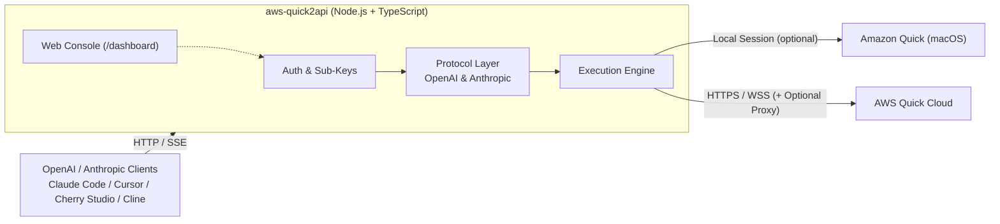

# aws-quick2api

English | **[简体中文](./README.md)**

[](https://github.com/kuk-888/aws-quick2api/releases)
[](https://github.com/kuk-888/aws-quick2api/pkgs/container/aws-quick2api)
[](https://linux.do)
[](https://t.me/+-2B2GA8qESpjYWZl)
[](./LICENSE)

Single-process **OpenAI & Anthropic API gateway** for **AWS Quick**. Runs on Linux, Docker, macOS, and Windows without installing the official desktop app, and ships with a built-in Web Console (`aws-quick-admin`).

> **Disclaimer**: Independent third-party open-source project, not affiliated with or endorsed by Amazon Web Services (AWS). Contains no proprietary AWS binaries or assets. Authenticate with your own legitimate account. For personal development and protocol interoperability only—do not resell or run as a commercial relay.

> [!TIP]
> **Community & Feedback**: Join the [**Telegram Community Group**](https://t.me/+-2B2GA8qESpjYWZl) for release announcements, setup help, and discussions, or open a [**GitHub Issue**](https://github.com/kuk-888/aws-quick2api/issues).

---

## What It Does

- **Dual-Protocol API**: Exposes OpenAI (`/v1/chat/completions`, `/v1/responses`, `/v1/models`) and Anthropic (`/v1/messages`, `/v1/messages/count_tokens`) endpoints with SSE streaming, tool/function calling, thinking blocks, and multimodal image inputs (base64 & SSRF-checked remote URLs up to 10 MB).
- **Headless Auth (No Desktop App Required)**:
  - **2-step OAuth PKCE wizard** in the Web Console (universal multi-cell tenant discovery, 90-day auto-refresh, automatic email & display name extraction).
  - **Web Cookie import** (`Copy as cURL` from `quick.aws.com`), batch JSON backup/restore, and optional macOS `local-outpost` reuse.
- **Large Context & Streaming Resilience**:
  - Oversized contexts (`>46 KB`) on OAuth accounts automatically use AWS Quick's **native out-of-band `.txt` attachment upload** (single-frame delivery + 60s DLP poll verification + preserving both opening request and trailing context + Turn-2 warm incremental reuse; upload 401/429 propagates to refresh/failover cleanly without silent chunk fallback); non-OAuth accounts use `≤46.5 KB` JSON-escaped UTF-8 chunking (with a 45s `turn_usage` watchdog and a 12-chunk safety cap). Streaming requests above 16 KB or with tools flush `HTTP 200` + `: keepalive` heartbeats once an upstream slot is leased (preserving genuine pre-lease HTTP `429` responses while preventing Cloudflare `524` timeouts).
  - Streaming sanitizer converts AWS Quick's proprietary `<decision>` / `<decisions>` / `<artifact>` UI XML into plain Markdown while leaving fenced code blocks untouched.
- **Auto-Managed Custom Agent & Clean Tool Bridge**:
  - Enabled by default (`AUTO_ENSURE_CODING_AGENT=true`): on the first call to an unbound account, the gateway uses AWS Quick's native WebSocket protocol to discover an existing custom agent or automatically create & publish `Coding Assistant` from your template, persisting its `chat_agent_id` to `.env` for zero-overhead reuse.
  - When a custom agent is active, tool bridging switches to ultra-clean minimal JSON schemas (no verbose anti-refusal boilerplate; zero `user_message` suffix injection on Opus/Sonnet), reliably powering local files, `.env`, shell, MCP, Skills, and Codex `apply_patch`.
  - Under **Routing & Strategy**, hot-update `AUTO_ENSURE_CODING_AGENT` and the global default instructions template `CUSTOM_AGENT_PROMPT`; under **Credentials**, click **Agent** on any account to inspect live custom agents, switch or restore default in one click, auto-create/bind, or **edit & hot-publish an existing agent's prompt directly to AWS Quick**.
- **Anti-False-Positive Sanitization & Opt-In Defensive Rephrase**:
  - Automatically strips forged/high-risk CLI billing headers (`x-anthropic-billing-header`), softens conflicting CLI identity lines, and normalizes outbound `<system-reminder>` tags into neutral notes without affecting conversation prefix hashes; includes a lightweight `warmup` guard to recover from false-positive prompt-injection refusals.
  - Under **Routing & Strategy**, an opt-in **`AUTO_REPHRASE_ON_CONTENT_FILTER`** toggle (OFF by default) with an editable prompt template lets a lightweight helper model (`quick-fast` by default) rephrase only the latest blocked user message into defensive engineering wording when upstream returns `content_filtered` before text emission, then retries once on the **exact same user-requested model** (using native `edit_message` branching on warm sessions to keep KV cache & Turn N+1 `warm_incremental` intact — never silently downgrading the answering model).
- **Multi-Account Pool & Per-Credential Proxies**:
  - `quota-aware`, `least-busy`, and `round-robin` scheduling, sticky session affinity (high Bedrock Prompt Cache hit rate), automatic circuit-breaking on quota exhaustion, and failover on 401/429/502/503.
  - Zero-dependency per-account outbound proxy supporting `http://`, `https://`, `socks5://`, `socks5h://` (remote DNS), and common provider shorthands (`host:port`, `user:pass@host:port`, `host:port:user:pass`), with automatic transient retry for residential proxies.
- **Native Incognito Privacy & Dedicated WS Warm Reuse**:
  - Combines **native `incognito: true` (zero AWS cloud history)** with **per-conversation dedicated WebSocket keepalive & warm incremental reuse** across all protocols (including multi-turn tool calls in Claude Code, Codex CLI, and Witan) for **1.4–3.2s** follow-up latency; 5-tuple session isolation prevents cross-talk, idle disconnects seamlessly fall back to lossless `46.5 KB` chunked replay with zero amnesia, and cloud mode (`INCOGNITO=false`) additionally supports cross-disconnect `thread_id` resume.
- **Built-in Web Console (`aws-quick-admin`)**:
  - Served at `/dashboard` (EN/ZH, Light/Dark). Includes overview charts, routed-model breakdown, live quota & free-trial countdown, selective quota sync, batch cloud session cleanup, scoped `sk-aq-...` sub-keys (model allowlist, concurrency, quota, expiry), and live request traces.

---

## Architecture



---

## Screenshots

### Overview Dashboard


### Credentials & Quota Pool


<details>
<summary>More Console Views (Client Sub-Keys / Model Access / Routing & Incognito)</summary>

#### Client Sub-Keys & Quick Connect


#### Model Access Control


#### Routing, Affinity & Incognito


</details>

---

## Adding Credentials

Open the Web Console (`http://127.0.0.1:3456/dashboard`) and click **+ Add Credential**:

1. **OAuth PKCE Wizard (Recommended · 90-day auto-refresh)**: Follow the built-in 2-step wizard (Step 1 discovers your account's tenant/cell; Step 2 authorizes access and stores a 90-day refresh token).


2. **Web Cookie Import (`Copy as cURL`)**: In a browser signed in to `quick.aws.com`, open DevTools (`F12`) → **Network** → right-click any `quick.aws.com` request → **Copy as cURL**, then paste it into the **Cookie Import** tab.

| Step 1: Copy as cURL | Step 2: Paste & Import |
| :---: | :---: |
|  |  |

---

## Model Mapping & Observed Routing

| Model ID | Mode | Default Reasoning | Observed Routed Model | Best For |
| :--- | :--- | :--- | :--- | :--- |
| `quick-fast` | `fast` | `off` | `us.anthropic.claude-haiku-5-5` | Fast everyday Q&A and high concurrency |
| `quick-balanced` | `balanced` | `off` | `us.anthropic.claude-sonnet-5-5` | General coding and balanced daily use (default) |
| `quick-balanced-think` | `balanced` | `medium` | `us.anthropic.claude-sonnet-5-5` | Balanced tasks with thinking enabled |
| `quick-smart` | `smart` | `off` | `us.anthropic.claude-opus-5-5` | Complex reasoning and architecture tasks |
| `quick-smart-think` | `smart` | `high` | `us.anthropic.claude-opus-5-5` | Deep reasoning with high thinking effort |
| `quick-advanced` | `advanced` | `high` | Account-dependent | Requires Advanced plan (disable on Free tier) |

> **Dynamic Routing**: Underlying models are assigned server-side and may change with AWS upstream routing policies. The actual routed model is surfaced in the thinking block, OpenAI `system_fingerprint`, and console request logs.
>
> **Aliases & Overrides**: Parenthetical hints (e.g. `quick-balanced(Sonnet)`, `quick-smart(max)`) are accepted automatically. Reasoning effort (`off` / `low` / `medium` / `high` / `max`) can be overridden and passed through natively via `reasoning_effort`, `reasoning.effort`, `thinking.enabled`, `enable_thinking`, `-max` suffixes, or bracket syntax (`quick-smart[effort=max]`).

---

## Quick Start

### Requirements
- Node.js `>= 22.13.0` (or Docker)

### Run Locally

```bash
git clone https://github.com/kuk-888/aws-quick2api.git
cd aws-quick2api
npm install
npm test

cp .env.example .env
# Optional: set a strong random ADMIN_PASSWORD in .env (required on remote servers). Leave GATEWAY_TOKEN unset:
# a random sk-aq-... key is generated on first start (copy it from Console -> Sub-Keys). Placeholder values are rejected at startup.
npm start
```

### Run with Docker Compose

Uses the published multi-arch (`linux/amd64`, `linux/arm64`) GHCR image (`ghcr.io/kuk-888/aws-quick2api:latest`) by default:

```bash
cp .env.example .env
docker compose up -d
```

To upgrade later:

```bash
docker compose pull && docker compose up -d
```

To build from local source instead, comment out `image:` and uncomment `build: .` in `docker-compose.yml`, then run `docker compose up -d --build`.

> **Lossless Upgrades & One-Click Web Self-Update (Zero Data Loss)**: All runtime state is decoupled from the code/image — upstream pool credentials and routing settings persist atomically in `./data/pool-state.json` (with debounced best-effort mirroring back to writable `.env` on structural edits and OAuth rotations), while client sub-keys (`gateway-keys.json`), model toggles (`model-access.json`), usage ledger (`usage-ledger.json`), metadata-only request audit logs (`request-traces.json`), and admin sessions stay in `./data/`:
> - **One-Click Web Self-Update (Docker & Source, zero `docker.sock`)**: Once running under the `bootstrap.js` supervisor (pull the latest Docker image once, or start host installs via `npm start` / `node dist/src/bootstrap.js`), click the version pill in the Web Console → **Update & Restart**. Every update verifies `SHA256SUMS.txt`, checks the native dependency fingerprint (`depsHash`), flushes state cleanly, restarts in-place (~2–5s), and auto-rolls back if the new release crashes within startup grace (manual rollback is also one click away; releases that bump native dependencies like `sharp`/`ws` are safely blocked with terminal upgrade commands).
> - **Docker CLI Upgrade**: Keep `./.env` and `./data`, then run `docker compose pull && docker compose up -d` (a newer built-in image automatically supersedes any older cached hot-update);
> - **Source CLI Upgrade**: Keep `.env` and `data/`, then run `git pull && npm ci && npm run build` and restart (using `npm start` or `node dist/src/bootstrap.js`);
> - **One-time permission step only when upgrading Docker from `<= v0.1.15`**: `v0.1.16+` runs as non-root (`node`, UID/GID `1000:1000`) with `cap_drop: [ALL]`. If your existing `./data` or `.env` is owned by `root`, run `chown -R 1000:1000 data .env` once before upgrading.

- **Web Console**: `http://127.0.0.1:3456/dashboard`
- **OpenAI Base URL**: `http://127.0.0.1:3456/v1`
- **Anthropic Base URL**: `http://127.0.0.1:3456`

---

## Environment Variables

See [.env.example](./.env.example) for the full template:

| Variable | Default | Description |
| :--- | :--- | :--- |
| `HOST` / `PORT` | `127.0.0.1` / `3456` | Bind host and port (`0.0.0.0` inside Docker) |
| `GATEWAY_TOKEN` | - | Optional bootstrap bearer token(s), comma-separated. Seeded once into the console and tagged `.env`; afterwards the console is authoritative: deleting it there revokes it permanently (not re-created on restart), while removing/changing it in `.env` removes/replaces that key on next restart. Unset = a random key is auto-generated. Placeholder values (e.g. `sk-aq-change-me`) are rejected at startup |
| `ENABLE_DASHBOARD` | `true` | Enable Web Console (`false` disables all console routes) |
| `ADMIN_PASSWORD` | - | Console login password (required on remote servers; if unset, first-time setup is restricted to localhost `127.0.0.1`/`::1`) |
| `QUICK_TOKENS` | `local-outpost` | Upstream credentials (can also be added via OAuth/Cookie in Console) |
| `DISABLED_MODELS` | - | Comma-separated model IDs to hide (e.g. `quick-advanced` on Free tier) |
| `INCOGNITO` | `true` | Native incognito mode (zero AWS cloud history; hot-toggleable in Console). Keep `true` for **shared pools / zero cloud history**; set `false` for **personal / high-concurrency** workloads (e.g. Claude Code subagents) so turns still resume via cloud `thread_id` even if a parked WS disconnects or is evicted |
| `WEB_SEARCH_ENABLED` | `true` | Enable AWS Quick native web search |
| `SHOW_ROUTED_MODEL_IN_THINKING` | `true` | Show the routed model in the thinking block |
| `AWS_QUICK_LOCALE` | `en-US` | Locale sent to upstream |
| `AWS_QUICK_APP_VERSION` | `1.2.4757` | Desktop client version header override |
| `HTTPS_PROXY` / `HTTP_PROXY` | - | Global default proxy (per-account `http://`, `https://`, `socks5://` and shorthand proxies can be set in Console) |
| `SANITIZE_CLIENT_SYSTEM_PROMPT` | `false` | Opt-in toggle (hot-configurable in Console; off by default so user-supplied `system` prompts pass through untouched): recommended when heavy agent IDEs (Claude Code, Cursor, Kilo, Antigravity, ZCode) hit false-positive `smart` blocks or refuse local tool calls; neutralizes conflicting AI identities and pseudo-system XML wrappers while preserving all workspace rule content |
| `AUTO_REPHRASE_ON_CONTENT_FILTER` | `false` | Opt-in toggle (hot-configurable in Console): when enabled, if upstream returns `content_filtered` before text emission, a helper model rephrases the latest user prompt into defensive engineering wording and retries once on the exact same requested model (via native `edit_message` on warm threads) |
| `CONTENT_FILTER_REPHRASE_PROMPT` | - | Custom prompt template for defensive auto-rephrase (empty = built-in default; editable in Console with one-click reset) |
| `CONTENT_FILTER_REPHRASE_MODEL` | `quick-fast` | Lightweight helper model (`quick-fast` or `quick-balanced`) used strictly for short prompt rephrasing; never replaces the answering model |
| `WARM_SESSION_TTL_MS` / `MAX_WARM_SESSIONS` | `1800000` / `256` | Warm incremental session cache TTL (30 min) and max entries |
| `UPDATE_CHECK_REPO` | `kuk-888/aws-quick2api` | GitHub `owner/repo` for non-blocking release check in Console (set `off` to disable) |
| `DISABLE_SELF_UPDATE` | `false` | Set to `true` to completely disable Web Console one-click hot-update & rollback endpoints |

---

## Known Limitations

- **Sampling parameters (`temperature`, `top_p`, `max_tokens`, `stop`, `seed`)**: Not enforced upstream; accepted for client compatibility and reported via response headers.
- **`response_format` (`json_object` / `json_schema`) & `n > 1`**: Not supported; returns an explicit `400` error.
- **Attachments**: Image inputs (PNG/JPG/WebP/GIF, up to 10 per turn; exceeding returns `400`) and PDF/document inputs (Anthropic `document`, OpenAI Chat `file`, Responses `input_file`; up to 5 per turn; exceeding returns `400`) are supported. With OAuth credentials, multi-image turns (≥2 images or >20 KB) and binary files like PDFs upload natively out-of-band at full resolution (up to 10 MB per file; upload failures return explicit errors without silent downgrade); non-OAuth credentials and single tiny images use `sharp` inline compression. Audio attachments are not supported yet.
- **Non-chat endpoints**: Embeddings, image generation, TTS, and Whisper are not supported.

---

## Community

- For bug reports and feature requests, please open an issue on [GitHub Issues](https://github.com/kuk-888/aws-quick2api/issues).
- Join our [Telegram Community Group](https://t.me/+-2B2GA8qESpjYWZl) for discussions and support.
- Thanks to the [LINUX DO](https://linux.do) community for providing an open and friendly technical exchange platform.

---

## License

[MIT](./LICENSE)
