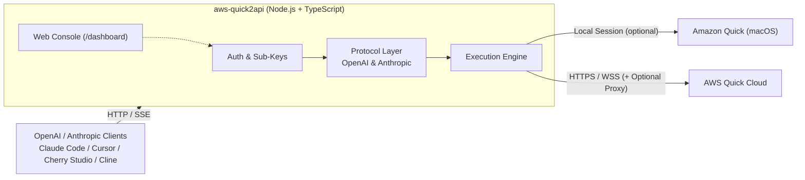
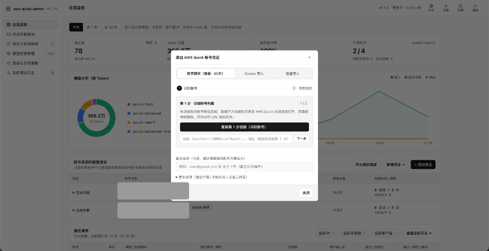
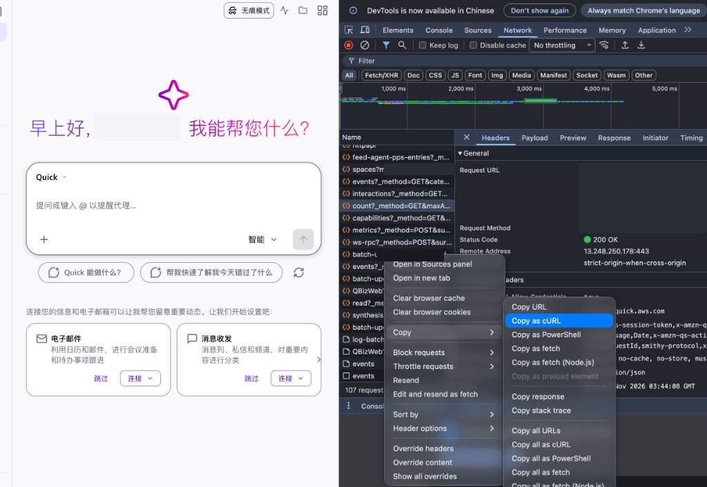

# aws-quick2api

English | **[简体中文](./README.md)**

[](https://github.com/kuk-888/aws-quick2api/releases)
[](https://github.com/kuk-888/aws-quick2api/pkgs/container/aws-quick2api)
[](https://linux.do)
[](./LICENSE)

Single-process **OpenAI & Anthropic API gateway** for **AWS Quick**. Runs on Linux, Docker, macOS, and Windows without installing the official desktop app, and ships with a built-in Web Console (`aws-quick-admin`).

> **Disclaimer**: Independent third-party open-source project, not affiliated with or endorsed by Amazon Web Services (AWS). Contains no proprietary AWS binaries or assets. Authenticate with your own legitimate account. For personal development and protocol interoperability only—do not resell or run as a commercial relay.

---

## What It Does

- **Dual-Protocol API**: Exposes OpenAI (`/v1/chat/completions`, `/v1/responses`, `/v1/models`) and Anthropic (`/v1/messages`, `/v1/messages/count_tokens`) endpoints with SSE streaming, tool/function calling, thinking blocks, and multimodal image inputs (base64 & SSRF-checked remote URLs up to 10 MB).
- **Headless Auth (No Desktop App Required)**:
  - **2-step OAuth PKCE wizard** in the Web Console (universal multi-cell tenant discovery, 90-day auto-refresh, automatic email & display name extraction).
  - **Web Cookie import** (`Copy as cURL` from `quick.aws.com`), batch JSON backup/restore, and optional macOS `local-outpost` reuse.
- **Large Context & Streaming Resilience**:
  - Automatic `≤50 KB` UTF-8 chunking for large prompts, plus early `HTTP 200` + `: keepalive` SSE heartbeats to prevent reverse-proxy/Cloudflare `524` timeouts.
  - Optional gateway safety-net compaction above `850K` tokens (`AUTO_COMPACT_OVERFLOW_TOKENS`, zero-touch below threshold so client Prompt Cache stays intact).
  - Streaming sanitizer converts AWS Quick's proprietary `<decision>` / `<decisions>` / `<artifact>` UI XML into plain Markdown while leaving fenced code blocks untouched.
- **Multi-Account Pool & Per-Credential Proxies**:
  - `quota-aware`, `least-busy`, and `round-robin` scheduling, sticky session affinity (high Bedrock Prompt Cache hit rate), automatic circuit-breaking on quota exhaustion, and failover on 401/429/502/503.
  - Zero-dependency per-account outbound proxy supporting `http://`, `https://`, `socks5://`, `socks5h://` (remote DNS), and common provider shorthands (`host:port`, `user:pass@host:port`, `host:port:user:pass`), with automatic transient retry for residential proxies.
- **Privacy & Warm Reuse**:
  - Native `incognito: true` by default (zero AWS cloud chat history). When incognito is turned off, enables `thread_id` warm incremental reuse on multi-turn chats.
- **Built-in Web Console (`aws-quick-admin`)**:
  - Served at `/dashboard` (EN/ZH, Light/Dark). Includes overview charts, routed-model breakdown, live quota & free-trial countdown, selective quota sync, batch cloud session cleanup, scoped `sk-aq-...` sub-keys (model allowlist, concurrency, quota, expiry), and live request traces.

---

## Architecture



---

## Screenshots

### Overview Dashboard


### Credentials & Quota Pool


<details>
<summary>More Console Views (Client Sub-Keys / Model Access / Routing & Incognito)</summary>

#### Client Sub-Keys & Quick Connect


#### Model Access Control


#### Routing, Affinity & Incognito


</details>

---

## Adding Credentials

Open the Web Console (`http://127.0.0.1:3456/dashboard`) and click **+ Add Credential**:

1. **OAuth PKCE Wizard (Recommended · 90-day auto-refresh)**: Follow the built-in 2-step wizard (Step 1 discovers your account's tenant/cell; Step 2 authorizes access and stores a 90-day refresh token).



2. **Web Cookie Import (`Copy as cURL`)**: In a browser signed in to `quick.aws.com`, open DevTools (`F12`) → **Network** → right-click any `quick.aws.com` request → **Copy as cURL**, then paste it into the **Cookie Import** tab.

| Step 1: Copy as cURL | Step 2: Paste & Import |
| :---: | :---: |
|  |  |

---

## Model Mapping & Observed Routing

| Model ID | Mode | Default Reasoning | Observed Routed Model | Best For |
| :--- | :--- | :--- | :--- | :--- |
| `quick-fast` | `fast` | `off` | `us.anthropic.claude-haiku-5-5` | Fast everyday Q&A and high concurrency |
| `quick-balanced` | `balanced` | `off` | `us.anthropic.claude-sonnet-5-5` | General coding and balanced daily use (default) |
| `quick-balanced-think` | `balanced` | `medium` | `us.anthropic.claude-sonnet-5-5` | Balanced tasks with thinking enabled |
| `quick-smart` | `smart` | `off` | `us.anthropic.claude-opus-5-5` | Complex reasoning and architecture tasks |
| `quick-smart-think` | `smart` | `high` | `us.anthropic.claude-opus-5-5` | Deep reasoning with high thinking effort |
| `quick-advanced` | `advanced` | `high` | Account-dependent | Requires Advanced plan (disable on Free tier) |

> **Dynamic Routing**: Underlying models are assigned server-side and may change with AWS upstream routing policies. The actual routed model is surfaced in the thinking block, OpenAI `system_fingerprint`, and console request logs.
>
> **Aliases & Overrides**: Parenthetical hints (e.g. `quick-balanced(Sonnet)`) are accepted automatically. Reasoning effort can be overridden per request via `reasoning_effort`, `reasoning.effort`, `thinking.enabled`, `enable_thinking`, or bracket syntax (`quick-balanced[effort=high]`).

---

## Quick Start

### Requirements
- Node.js `>= 22.13.0` (or Docker)

### Run Locally

```bash
git clone https://github.com/kuk-888/aws-quick2api.git
cd aws-quick2api
npm install
npm test

cp .env.example .env
# Edit .env to set ADMIN_PASSWORD and GATEWAY_TOKEN
npm start
```

### Run with Docker Compose

```bash
cp .env.example .env
docker compose up -d --build
```

When using published multi-arch (`linux/amd64`, `linux/arm64`) GHCR images (`ghcr.io/kuk-888/aws-quick2api:latest`):

```bash
docker compose pull && docker compose up -d
```

- **Web Console**: `http://127.0.0.1:3456/dashboard`
- **OpenAI Base URL**: `http://127.0.0.1:3456/v1`
- **Anthropic Base URL**: `http://127.0.0.1:3456`

---

## Environment Variables

See [.env.example](./.env.example) for the full template:

| Variable | Default | Description |
| :--- | :--- | :--- |
| `HOST` / `PORT` | `127.0.0.1` / `3456` | Bind host and port (`0.0.0.0` inside Docker) |
| `GATEWAY_TOKEN` | - | Comma-separated client bearer token(s) |
| `ENABLE_DASHBOARD` | `true` | Enable Web Console (`false` disables all console routes) |
| `ADMIN_PASSWORD` | - | Console login password (required on remote servers; if unset, first-time setup is restricted to localhost `127.0.0.1`/`::1`) |
| `QUICK_TOKENS` | `local-outpost` | Upstream credentials (can also be added via OAuth/Cookie in Console) |
| `DISABLED_MODELS` | - | Comma-separated model IDs to hide (e.g. `quick-advanced` on Free tier) |
| `INCOGNITO` | `true` | Native incognito mode (zero AWS cloud history; hot-toggleable in Console) |
| `AUTO_DELETE_SESSION` | `false` | Send extra `session_delete` RPC after each incognito turn (off by default) |
| `WEB_SEARCH_ENABLED` | `true` | Enable AWS Quick native web search |
| `SHOW_ROUTED_MODEL_IN_THINKING` | `true` | Show the routed model in the thinking block |
| `SUPPRESS_LATE_ROUTED_THINKING_IN_STREAM` | `false` | Set `true` only if a legacy OpenAI SSE client cannot handle a trailing `reasoning_content` chunk |
| `SANITIZE_AWS_UI_TAGS` | `true` | Convert AWS Quick `<decision>`/`<artifact>` XML into Markdown (preserves fenced code blocks) |
| `AWS_QUICK_LOCALE` | `en-US` | Locale sent to upstream |
| `AWS_QUICK_APP_VERSION` | `1.2.4660` | Desktop client version header override |
| `HTTPS_PROXY` / `HTTP_PROXY` | - | Global default proxy (per-account `http://`, `https://`, `socks5://` and shorthand proxies can be set in Console) |
| `AUTO_COMPACT_OVERFLOW_TOKENS` | `850000` | Safety-net compaction threshold for oversized prompts (`0` to disable) |
| `AUTO_COMPACT_SUMMARY` | `true` | Summarize middle history when overflow compaction triggers |
| `WARM_SESSION_TTL_MS` / `MAX_WARM_SESSIONS` | `1800000` / `256` | Warm incremental cache TTL (30 min) and max entries when `INCOGNITO=false` |
| `UPDATE_CHECK_REPO` | `kuk-888/aws-quick2api` | GitHub `owner/repo` for non-blocking release check in Console (set `off` to disable) |

---

## Known Limitations

- **Sampling parameters (`temperature`, `top_p`, `max_tokens`, `stop`, `seed`)**: Not enforced upstream; accepted for client compatibility and reported via response headers.
- **`response_format` (`json_object` / `json_schema`) & `n > 1`**: Not supported; returns an explicit `400` error.
- **Attachments**: Image inputs (PNG/JPG/WebP/GIF) are supported. Because AWS Quick enforces a 50 KB single-frame WebSocket limit, oversized images are automatically downscaled and JPEG-compressed (`sharp`) to fit; for dense small-font tables or code screenshots, cropping to the target area yields sharper OCR. PDF, document, and audio attachments are not supported yet.
- **Non-chat endpoints**: Embeddings, image generation, TTS, and Whisper are not supported.

---

## Community

For bug reports and feature requests, please open an issue on [GitHub Issues](https://github.com/kuk-888/aws-quick2api/issues).

Thanks to the [LINUX DO](https://linux.do) community for providing an open and friendly technical exchange platform.

---

## License

[MIT](./LICENSE)
